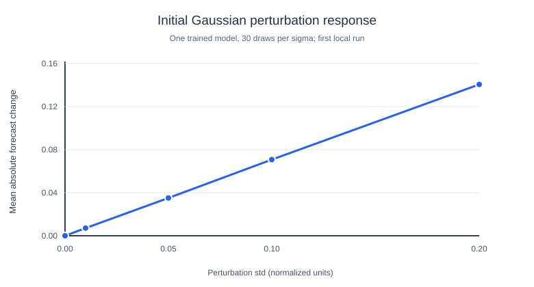

# First Transformer perturbation run — confirmed on Windows

**Date:** 2026-10-20  
**Provenance:** VS Code PowerShell output provided by the researcher after running scripts in the cloned GitHub repository. Values in the version-controlled CSV snapshots below are transcribed from the displayed terminal (rounded to the printed precision). Full per-draw results, checkpoint weights and the PNG plot remain on the researcher's own computer; they were **not** uploaded to GitHub.

## Commands completed successfully

```powershell
py code/generate_perturbation_data.py
py code/test_perturbation_pipeline.py
py code/transformer_model.py
py code/perturbation_experiment.py
```

Smoke test: `PASS: chronological splits, historical windows, forward/backward pass`.

Training ran 10 epochs, with the **best validation loss at epoch 5**, then stopped because the validation loss did not improve for five consecutive epochs.

[Recorded training losses (CSV)](observed_training_2026-10-20.csv)

| Clean Transformer test metric | Value |
| --- | ---: |
| MSE (original units) | 1.045586 |
| MAE (original units) | 0.808803 |
| RMSE (original units; from test MSE) | ~1.022539 |
| Best validation MSE (normalized units) | ~0.495638 |

The clean test has 750 held-out target indices (4250–4999). The metric values are based on a single trained Transformer.

## Recorded Gaussian perturbation results

The model weights and original test targets were held constant. At each sigma, 30 independent perturbation draws were applied to normalized historical test windows.

[Recorded perturbation summary (CSV)](observed_perturbation_2026-10-20.csv)

| Gaussian perturbation σ | Mean abs. forecast change | Std. across 30 repeats | Mean RMSE against original targets | NMSE / train variance |
| ---: | ---: | ---: | ---: | ---: |
| 0.00 | 0.000000 | 0.000000 | 1.022539 | 0.501934 |
| 0.01 | 0.007119 | 0.000197 | 1.022638 | 0.502031 |
| 0.05 | 0.035094 | 0.001057 | 1.023279 | 0.502662 |
| 0.10 | 0.070765 | 0.001836 | 1.027424 | 0.506746 |
| 0.20 | 0.140584 | 0.003439 | 1.040837 | 0.520081 |



**Interpretation:** The mean absolute change in the forecast rises nearly proportionally with sigma over the tested range. The model's held-out RMSE also increases, but by a smaller relative amount. Perturbation response and prediction accuracy are different measurements.

## What was — and was not — established

- **Established:** The generated data, chronological splitting, forward/backward test, training, early stopping, held-out evaluation, and perturbation pipeline executed successfully in VS Code.
- **Established:** The first trained Transformer has measured forecast sensitivity to Gaussian input noise with varying variance.
- **Not yet established:** Whether these response curves generalize across model-training seeds, different datasets, or distribution-shift scenarios.
- **Now established for this single dataset/seed:** the fitted AR(1) and frozen Transformer comparison also ran successfully in the researcher's Windows terminal. See the [confirmed AR(1) comparison](linear_baseline_validation.md) for its results; no general cross-dataset ranking follows.
- **Not uploaded:** The researcher's local `transformer.pt`, `config.json`, raw `perturbation_metrics.csv`, and generated PNG. Re-run scripts to recreate those files locally; the Git repository intentionally ignores them.

For methodological background, see [Perturbation Methods](../PERTURBATION_METHODS.md). The next directional study is documented in [Directional Perturbations](../DIRECTIONAL_PERTURBATIONS.md).
